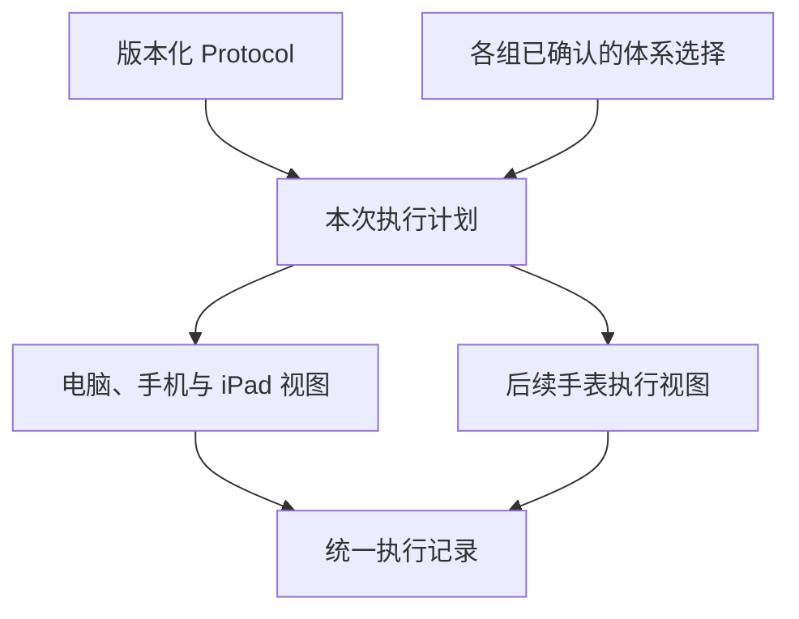

# LabNest 结构化科研编辑与多体系 Protocol 执行需求文档

版本：v1.1  
日期：2026-10-14  
对象：负责 LabNest 架构、前端、数据迁移与验收的 Codex  
范围：全站文本编辑基础、多体系规程、实验执行、Entry／结果关联，以及手机、iPad、手表的分阶段支持

本次修订：按用户指定，将 Matt Pocock skills、Impeccable、Ponytail 纳入必须执行的工作流程，补充调用、阶段产物及使用证据要求；详见第14节与F08。

## 1. 核心决策

**把 Protocol 从“带格式的说明文字”提升为“含有明确步骤、适用条件、参数和工具的结构化规程”。全站共用编辑基础，实验执行使用独立的状态与记录。**

需要调整底层内容与执行逻辑，但不预设必须推倒整个项目或更换编辑器。先核查现有框架、数据格式和步骤生成方式，优先扩展可复用部分，再分批迁移。

本轮设计作出以下决定：

1. 通用预览显示全部体系；使用统一的颜色、形状标识和文字名称区分。
2. 执行时先确认本次使用的体系，默认只显示适用的步骤和参数；其他体系可以展开查看，但不会被删除。
3. “同一步的不同用量”用条件参数表达；“只有某体系才需要做的操作”用条件步骤表达，不能把两者混在一起。
4. 只有明确声明的操作步骤生成执行勾选。段落、标题、表格行、计时器、计算器和普通待办不会自动成为实验步骤。
5. 规程版本、本次实验采用内容、执行状态分别保存；修改模板不改变已经开始的实验。
6. 手机和 iPad 优先支持清晰的执行视图；手表后续承接当前步骤、关键参数、计时和完成操作。
7. 以上核心功能均不依赖 AI。AI 可辅助整理旧资料，确认后的结构化规则才参与执行。

**本文件是目标需求，不是当前实现审计。** 已实际查看三张用户截图，并核对相关官方技术资料；尚未读取本机 LabNest 源码、数据库或正在运行的系统。文中的对象名、字段名和模块划分是建议契约，Codex 应映射到真实项目，不能声称已有对应实现。

## 2. 参考截图及其设计含义

| 用户提供的截图 | 实际可见内容 | LabNest 应借鉴的能力 |
| --- | --- | --- |
| Screenshot 2026-10-14 at 00.24.16.png | ▲ 对应处理 350 µL 裂解液；■ 对应处理 600 µL 裂解液 | 体系具有固定、可追踪的标识，在顶部图例和正文中一致使用 |
| Screenshot 2026-10-14 at 00.24.25.png | 同一步中出现 ▲／■ 两种用量；另有“仅适用于富脂组织”的条件说明 | 同时支持条件参数与独立的样本条件；黄色强调不能被程序当成第三种体系 |
| Screenshot 2026-10-14 at 00.31.44.png | 正文中嵌有体积组件、计时器和参数编辑浮层 | 文字可与有明确含义的科研组件混排，组件可编辑、可保存、可在执行时操作 |

截图中的数值仅用于说明交互和建立一致性测试，不构成新的实验方案，也不能仅凭截图片段判断完整适用条件。正式导入规程时应由作者核对完整原文。

官方资料确认 protocols.io 区分步骤、章节、子步骤和 step-cases，并提供科研组件及执行模式；本项目借鉴这些结构思想，不照搬其品牌、界面或商业实现。[R1–R2]

## 3. 全站编辑范围：统一基础，按用途提供能力

Codex 必须遍历真实路由和组件，建立“页面／字段—编辑器—保存格式—预览方式—验收结果”清单。下面是覆盖要求，不代表所有模块已存在；不存在的模块记为不适用，不因本文件新建业务模块。

| 区域 | 适合的编辑能力 | 与实验执行的关系 |
| --- | --- | --- |
| Protocol 新建、编辑、模板 | 完整科研编辑：步骤、体系、条件、参数、表格、图片、工具、文献 | 唯一的规程定义来源 |
| Protocol 预览及实验创建预览 | 同一内容的只读呈现；全部体系／指定体系预览 | 只预览，不启动计时器或写入完成状态 |
| 实验方案、目的与设计 | 文档编辑、分组表、样本及规程引用、计算结果 | 描述实验安排；不把所有段落变成执行步骤 |
| 实验执行 | 适用步骤、关键参数、计时、实际值、偏差、备注、照片 | 操作写入本次执行记录，不直接改模板正文 |
| Entry 快速记录 | 轻量工具栏，文字、图片、表格、记录时间、引用；按需插入工具 | 先记录，后归入实验或结果，保留来源 |
| 实验结果、观察和分析记录 | 图片、表格、数据、实际参数、计算快照、来源与解释 | 绑定实验、组别和可选的具体步骤 |
| 项目／研究计划／知识笔记 | 文档编辑、任务清单、链接、引用 | 普通任务清单不自动进入实验进度 |
| 样本／试剂／设备说明 | 简洁富文本、附件和必要参数 | 作为材料或设备引用，不复制整篇说明 |
| 评论、步骤短备注、图片说明 | 轻量输入，按需支持基础格式与附件 | 不加载完整 Protocol 工具栏 |
| 计算器嵌入结果 | 可追溯的输入、单位、结果和版本，必要时插入表格 | 与来源工具关联；不重新实现一套公式 |
| 搜索摘要、打印和已有导出 | 从同一内容结构生成适合的只读表示 | 不读取临时编辑器 DOM 作为唯一内容来源 |
| 标题、编号、标签、数值等短字段 | 原有普通输入控件 | 无须全部改为富文本 |

共享的是段落、图片、表格、选择与撤销等基础能力；不同页面通过能力配置显示相应工具。不能为统一技术而让快速记录也面对一整套复杂规程面板。

## 4. 用户如何编写与使用多体系规程

### 4.1 编写体系

Protocol 编辑器顶部增加紧凑的“实验体系”入口。作者可以：

1. 定义选择项，如板型、反应体积、样本属性。
2. 设置选项名称、文字标识、形状和颜色；量值与单位分开保存。
3. 组合为常用方案，如“6孔板／方案A”“12孔板／方案B”，减少执行时重复选择。
4. 指定适用范围：整次实验或实验组；样本级差异在后续阶段扩展。
5. 维护合法组合，例如某个体积只允许在部分容器使用。

界面优先展示容易理解的“方案”，底层保留可组合的维度。首个版本不提供任意复杂公式编程界面。

板型、体系体积和样本属性不能相互推断：选择 6 孔板不代表系统自动知道应使用多少试剂；选择 350 µL 体系也不代表知道是否为富脂样本。

### 4.2 给内容设置适用范围

作者选中内容后，在就近工具条中选择“适用体系”；也可从步骤菜单或参数面板设置。

| 差异是什么 | 作者操作 | 保存的含义 |
| --- | --- | --- |
| 同一操作，仅用量不同 | 插入一个参数，按体系填写不同值 | 一个步骤、一个参数定义、多个明确值 |
| 某段说明不同 | 将该段落设为条件内容 | 不额外生成执行勾选 |
| 整个操作仅部分情况需要 | 设置该步骤的适用条件 | 一个有条件的操作步骤 |
| 表格部分行只适用某体系 | 设置行的适用条件，或在单元格插入条件参数 | 表头及单位保留，过滤后不能留下错位表格 |
| 一段流程有不同操作顺序 | 建立分支步骤组 | 每个分支含明确的步骤，不用颜色或标题猜顺序 |

共同内容只保存一份；“全部体系适用”是明确语义，不需要给每个体系复制一份正文。移动内容时适用条件随内容移动。

### 4.3 通用预览

- 顶部显示体系图例，如“▲ A · 350 µL”“■ B · 600 µL”。颜色只作辅助，文字和形状在黑白打印时仍能辨认。[R3]
- 条件参数在原句中并列显示，较长差异可用紧凑对照表。不要整段铺满深色背景。
- 整块条件内容在左侧或标题旁显示适用标签；共同步骤保持普通样式。
- 体系颜色和“警告／错误／完成”等状态颜色分开，不让一种红色同时表示某体系和错误。
- 提供“全部体系”和“预览某方案”。这里只改变视图，不保存为某次实验的实际选择。
- 折叠与展开直接显隐，正文不出现无必要的动画或位置跳跃。

### 4.4 开始实验时选择

创建实验时确认规程版本。进入执行页面后，第一张“实验准备”卡片提示选择本次体系；也可在创建实验时选择，执行开始时清楚展示已采用方案。

这个选择卡片属于流程准备，不自动增加一个实验操作步骤。用户可以先阅读共同说明，但在第一条依赖该选择的操作之前必须完成确认。推荐选项只作建议，不能悄悄当成已经选择。

执行页顶部持续显示实验名、当前组和所选体系；关键参数旁保留必要的体系／组标识，避免长页面滚动后失去上下文。

### 4.5 未选择内容如何处理

**默认收起已经确定不适用的内容，保留“查看其他体系”的入口。** 展开时以较弱样式和“不适用于本次实验”文字显示，不提供完成按钮。

不默认使用删除线，以免与作废内容或已完成状态混淆。隐藏只是呈现变化，原规程和本次判定依据仍保留。

条件必须有三种结果：

| 判断结果 | 显示 | 是否可以执行 |
| --- | --- | --- |
| 适用 | 显示当前内容及解析后的参数 | 满足其他必要输入后可以 |
| 不适用 | 默认收起；按需查看 | 不进入本次操作清单 |
| 尚未确定 | 显示“待选择体系／待填写条件” | 不能用任一候选参数执行 |

未选择不能被当成“不适用”；也不能默认取第一个匹配项。单值参数无值或匹配多个值、互斥分支同时命中、非法组合必须明确提示，而不是静默采用任意结果。彼此独立的条件内容允许同时适用，例如“350 µL体系”与“富脂样本”的说明可以同时显示。

### 4.6 截图对应的交互示例

以下只复现截图中可见的参数关系，属于软件验收样例：

| 位置 | 通用预览 | 选择 A：350 µL | 选择 B：600 µL |
| --- | --- | --- | --- |
| 截图步骤8中的 Proteinase K 用量 | ▲ 50 µL；■ 80 µL | 显示 50 µL | 显示 80 µL |
| 截图步骤9中的乙醇用量 | ▲ 200 µL；■ 350 µL | 显示 200 µL | 显示 350 µL |
| 截图步骤10的共同时间 | 10 min | 10 min | 10 min |
| “仅适用于富脂组织”的内容 | 显示样本条件 | 仍由样本属性决定 | 仍由样本属性决定 |

此例也说明，不能把 600／350 的比例直接乘到所有用量，更不能把共同时间也一起放大。

## 5. 科研组件：文字中嵌入有含义的对象

图标只是识别入口，组件本身必须保存可解释的数据。下面名称为目标概念，不是现有 API 名称。

| 组件 | 编辑时 | 执行时 | 记录要求 |
| --- | --- | --- | --- |
| 量值与单位 | 填写数值、单位、参数名；可绑定体系 | 显示本次采用值；按作者设定录入实际值 | 保留规定值、采用值、实际值，不能互相覆盖 |
| 时间／温度／离心条件 | 设置有单位的条件；可引用参数 | 以紧凑信息块显示 | 不把 rpm 与 ×g 自动当作可直接互换 |
| 计时器 | 设置时长、名称、所属步骤 | 手动开始、暂停、恢复、结束 | 保存本次计时实例，编辑和预览不自动启动 |
| 计算器 | 选择已有工具，绑定允许的输入／输出 | 就近打开；计算成功后确认采用结果 | 保存输入、单位、工具版本、结果、时间 |
| 记录字段 | 数字、文本、选择、照片等；标明必填与否 | 记录观察、测量值、偏差 | 关联实验、组别、步骤、作者与时间 |
| 材料／样本／设备引用 | 引用已有对象 | 查看名称及必要信息 | 保留引用 ID 与当时显示信息，权限受原系统约束 |
| 图片／文件／表格 | 保留现有编辑能力并修复问题 | 就近查看、补充或拍照 | 复用原始资产，缩略图不是独立用户文件 |
| 提示／说明／文献 | 普通内容或有条件的说明 | 阅读、展开引用 | 不计入执行步骤 |

桌面提供固定的少量常用按钮、“插入”菜单及可选的斜杠快捷菜单；触屏必须有同等可用的按钮入口，不能依赖键盘或悬停。组件较小时采用行内标签，参数较多时点击打开面板；不能把完整计算器塞入一行文字。

选择文字后打开插入面板应保存选区；关闭后回到原编辑位置。组件应支持明确的删除、复制、撤销与重做规则；快捷键不能破坏中文输入法正在组合的文字。

### 5.1 计算器与条件参数的边界

- 复用 LabNest 已有计算逻辑，不在 Protocol 内复制第二套公式。
- 明确区分固定值、体系查表值、公式计算值和人工实际值；每个参数只有一个确定的有效来源。
- 允许缩放的参数须由作者显式标记适用规则。浓度、培养面积、反应比例、时间等不得因改板型自动线性换算。
- 参数修改后，相关旧计算结果标记为“需重新计算”；在确认新结果前不静默替换已经记录的采用值。
- 依赖失效计算结果的待执行操作，在重新计算并确认前不能继续使用旧值执行；已经完成的操作保留当时采用值，不能追溯改写。
- 计算失败时保留输入并定位错误，不把上一次结果包装成本次成功结果。
- 嵌入工具在关闭 AI 后仍然可用；其普通计算不计入 AI 调用。

## 6. 底层内容与执行模型

### 6.1 必须分开的三层

| 层次 | 作用 | 关键约束 |
| --- | --- | --- |
| 版本化规程 | 正文、步骤、条件、参数、工具定义、附件引用 | 已用于实验的版本可追溯 |
| 本次执行计划 | 所用版本快照、组别、已确认选择、解析后的步骤及参数 | 不随模板后续修改自动变化 |
| 执行记录 | 完成、跳过、计时、实际值、照片、偏差、结果 | 与正文分开保存，按稳定身份关联 |



“同一份内容”不是让每次实验实时读取最新模板。创建实验时必须固定所用版本及相关内容；附件可引用同一不可变资源，不需要复制二进制文件。后续模板删除或附件清理不能破坏已引用的实验记录。

### 6.2 建议的数据对象

| 对象 | 至少应表达的信息 |
| --- | --- |
| 文档版本 | 文档 ID、版本 ID、结构版本、内容树、附件引用、创建与修订信息 |
| 选择维度／方案 | 稳定 ID、名称、可选值、范围、颜色与形状标识、合法组合 |
| 条件 | 对哪些已定义选项进行判断，以及明确的与／或组合 |
| 步骤 | 稳定步骤 ID、可选短标题、正文、适用条件、所属步骤组、完成要求 |
| 参数 | 稳定参数 ID、名称、量纲、单位、值来源及引用关系 |
| 工具定义 | 稳定组件 ID、工具类型及版本、输入输出绑定、所属内容 |
| 执行实例 | 实验 ID、组 ID、源版本、选择快照、采用参数、计划修订号 |
| 操作记录 | 操作 ID、步骤实例 ID、动作、作者、发生时间、接收时间、结果与备注 |
| 资产与引用 | 原始文件 ID、正文引用、缩略图关系、上传状态、删除／恢复关系 |

不得使用数组下标、步骤标题或显示序号作为记录关联键。步骤重排后，完成状态、图片、结果和计时器不能跟到另一步。

### 6.3 步骤与普通内容

- 标题、编号列表、普通 checkbox、表格行不是执行步骤的隐式定义。
- 一个步骤可以包含多段文字、表格、图片和工具；仍只有一个明确的完成对象。
- 章节和纯分组容器不再额外计数。父项为分组时，其进度由可执行子步骤汇总。
- 步骤标题可选；正文已表达完整动作时，使用简短编号标签即可，不自动截取正文再重复显示一次。
- 显示编号允许随视图调整，同时保留原规程位置或来源步骤标识，交叉引用按稳定 ID 跳转。

### 6.4 条件和解析规则

采用受限、可验证的规则结构，不执行作者输入的任意 JavaScript，也不通过文字颜色或自然语言临时猜条件。首版支持明确选项、条件块、查表参数和基本与／或关系；复杂循环、任意脚本与通用流程编排器不进入首版。

解析过程可表示为：

> 固定规程版本 ＋ 已确认的组别与选择 ＋ 参数输入 → 本次适用步骤、采用值、未确定项和不适用原因。

这是一项确定性逻辑，不是生成一篇新的规程。编辑、预览、执行、复制和导出应共用规则解释，不能各写一套过滤条件。

作者准备将版本用于新实验前，应检查：引用失效、允许组合缺少参数、互斥分支冲突、单值参数多重匹配、单位不兼容、依赖循环及条件无法满足。普通条件内容之间的交集不自动视为错误。草稿可保存未完成内容，但不允许以缺失关键参数的状态开始相关操作。

### 6.5 简化结构示例

下面是说明语义的自定义 JSON 示例，不是 Tiptap 或现有 LabNest 的可直接运行格式。实际实现需定义并验证完整结构。

```json
{
  "schemaVersion": 1,
  "selections": [
    {
      "id": "lysate_scale",
      "label": "裂解液体系",
      "scope": "group",
      "options": [
        {"id": "scale350", "label": "350 µL", "symbol": "triangle"},
        {"id": "scale600", "label": "600 µL", "symbol": "square"}
      ]
    }
  ],
  "parameters": [
    {
      "id": "proteinase_k_volume",
      "dimension": "volume",
      "unit": "uL",
      "source": {
        "kind": "lookup",
        "selectionId": "lysate_scale",
        "values": {"scale350": 50, "scale600": 80}
      }
    }
  ],
  "steps": [
    {
      "id": "step8",
      "title": "加入 Proteinase K",
      "body": [
        {"type": "text", "text": "加入 "},
        {"type": "parameterRef", "parameterId": "proteinase_k_volume"},
        {"type": "text", "text": " Proteinase K，并混匀。"}
      ]
    }
  ]
}
```

颜色由选项的显示配置决定，不参与参数求值。实验保存选择 `scale350` 后解析为 50 µL；选择 `scale600` 后解析为 80 µL；未选择时不得产生有效的采用值。

## 7. 实验执行、分组与变更

### 7.1 单组与多组

首个可验收版本支持单组完整流程；数据模型从第一天包含执行范围，避免以后无法兼容多组。后续阶段交付多组界面。

每组独立保存体系和采用参数。实验级共享准备只执行一次；各组分别进行的操作产生不同的步骤实例。只有用户明确选择“应用到这些组”时才批量修改，并逐组检查合法性。

实验级共享步骤不能任取某一组的参数。相关组采用值不同时，应拆成组级操作，或由作者明确配置逐组清单／汇总计算；系统不自动把不同体系的加样操作合并成一次。

如果首版界面暂不支持一项实验混用多个体系，应清楚引导拆成独立执行实例，不能用一个总开关覆盖所有组。

### 7.2 执行中改选

| 当前情况 | 行为 |
| --- | --- |
| 尚未执行受影响操作 | 展示变化后改选，更新待执行计划 |
| 只完成了不受影响的共同步骤 | 保留其状态，更新后续步骤及参数 |
| 已完成受影响步骤，或该步骤有实际值／结果／活动计时器 | 不允许静默覆盖；首版引导新建执行实例继续，保留原记录并标明关联 |
| 已结束实验 | 固定原记录；新体系通过新实验／新执行实例开展 |

后续若实现“同一实验中修订执行计划”，须保留前后快照、采用参数、影响清单和变更理由。旧完成状态不能直接套用到新参数。首版不为了支持复杂改选引入难以验证的自动重算。

新建实例继续时，须明确关联原实例与继续位置，展示样本此前已经经历的处理及原采用参数；不能把已处理样本当作全新样本，也不能把原完成记录复制为新体系下的完成事实。

改选使活动计时器不再适用时，应明确处理该计时器，不能留下不可见的后台任务；取消操作本身也要记录。

### 7.3 完成状态和进度

- 进度按本次适用的、明确可执行的步骤实例统计；不按段落数、所有分支数或复选框数量计算。
- “不适用”从本次分母排除；“待选择”保留为未确定项，不能提前显示全部完成。
- “已完成”“人工跳过”“不适用”分开保存与展示。人工跳过须有简短理由，不伪装成已完成。
- 人工跳过的必需步骤仍保留在应执行分母中，不得通过移除它而显示100%完成；若允许结束该实验，应显示“已结束，含跳过步骤”。
- 必需步骤与作者明确设置的可选步骤分开统计；未满足必填记录时不能假定已完成。
- 多组汇总不重复计算实验级共享准备。
- 计时结束只改变计时状态，不自动证明实验操作已经完成。
- 存在待同步或冲突时，页面不能用“全部已保存”掩盖实际状态。

## 8. Entry、结果与原始时间

延续“先快速记录、后归入”的交互。Entry 本身不需要预先选择某个 Protocol 才能创建。

1. 归入实验或结果时建立来源关联，避免复制正文和再次上传图片。
2. 分别保存原始创建时间、用户填写的观察／实验发生时间、最近修改时间和归入时间；后两者不能覆盖原始记录时间。
3. 草稿关联可显示同一 Entry 的最新内容并标明来源；确认实验结果或导出归档时固定引用的 Entry 版本，避免后续编辑静默改写历史结论。
4. 从实验步骤新建 Entry 时可自动带入实验、组别和步骤关联，但不能把观察文字自动变成新的操作步骤。
5. Entry 内的计时器或计算器是独立工具实例；归入记录不隐式重启工具，也不把工具状态复制成第二份。
6. 删除正文中的图片引用与删除原始文件分开处理；仍被其他记录或历史版本引用的资源不能立即物理删除。

## 9. 富文本可靠性：本次改造的前置质量要求

现有问题必须进入回归验收，不能用“将来换编辑器”代替修复。先复现原因，再决定修补共享核心还是迁移实现。

### 9.1 光标、选择、标题和中文输入

- 修改 H2、粗体、列表和参数时，光标与视野保持在当前操作附近；不要每次保存或工具栏操作都强制回顶、聚焦到开头或滚动到异常位置。
- 需要滚动时，只将目标调整到可见区域；不全面禁用正常的选区滚动。
- 中文输入法组合期间不重复提交、切断文字或重建编辑器；保存后不得出现重复汉字、丢字或符号错位。
- 更新一个工具组件，不应重建整篇文档。自动保存的服务端回读不得覆盖正在输入的本地内容。
- 撤销一次应对应合理的用户动作；重新载入页面不宣称能恢复未实现的无限撤销历史。

### 9.2 表格、图片与附件

- 修复表格插入菜单布局；检查插入、增删行列、合并拆分（若提供）、粘贴、滚动和保存回读。
- 表格长内容在自身区域处理，不撑破手机整页；工具浮层不能遮住正在编辑的单元格。
- 同一文档内拖动图片是移动原节点，不重复上传、不新增第二个引用；明确执行复制时才产生新节点。
- 复制节点可共享同一原始资产，但节点 ID 必须不同；移动节点保留 ID。复制跨文档时同时验证权限与引用关系。
- 四张照片的验收分别核对“4个有效图片引用”和“4个原始用户文件”，缩略图、预览缓存、下载占位不计为新文件。
- 对用户原先出现“4图显示7文件”的记录逐项核对多出的对象，不能只改显示数字或批量删掉陌生记录。
- 上传失败保留明确失败状态及重试；重复回调和重试不造成多份成功文件。
- 删除、撤销、重新插入与刷新回读都要验证附件关系。

### 9.3 内容往返与安全呈现

富文本保存后重新读取、复制到新文档、预览和导出，均须保留有效内容及语义。未知旧节点应保留为可查看的兼容内容并提示维护者，不得因新结构不认识就静默删除。

对导入 HTML 和外部粘贴内容采用项目既有安全处理，保留必要科研格式；不允许任意脚本或未经登记的可执行嵌入。结构校验和 HTML 清理不能互相抵消，导致条件、图片或表格丢失。

## 10. 计时、离线与多设备

### 10.1 计时器保存时间事实

至少保存计时器实例 ID、所属实验／组／步骤、状态、开始时间、预计结束时间、暂停时的剩余时长及修订号。显示的倒计时根据这些时间计算，不能将“每秒减一”的界面变量当作真实状态。

刷新、返回前台或换设备时重新计算。联网时校验设备时钟偏差；检测到系统时间异常变化时明确处理，不能悄悄生成可信度不明的精确时间。暂停和恢复不会重建第二个计时器。

浏览器后台页的定时回调可能被节流。因此“恢复后显示正确时间”和“锁屏时准时提醒”必须分开验收。[R6]

### 10.2 提醒能力独立实现

P1实现前台提示和状态恢复。后续按实际环境增加 Web Push 或原生通知，并展示本设备的权限及能力状态；不因界面有铃铛就宣称能在后台提醒。

iPhone／iPad 的主屏幕 Web App 在支持环境中可申请 Web Push，授权需来自用户直接操作。通知可以出现在配对手表上，但这不等于手表已有可操作的实验执行应用。[R7]

跨设备默认指定主要提醒设备，并以计时器 ID 和修订号避免重复调度。取消或重设后，旧版本提醒应撤销或忽略；断网条件下不承诺所有设备绝对同步去重。

### 10.3 离线记录与冲突

离线完整能力在后续阶段交付，首版应如实显示联网保存状态，不把未上传照片表示为已同步。

离线阶段至少实现：

- 用户明确下载的实验快照、必要附件和采用体系可离线查看。
- 本地操作先持久保存再显示“已保存至本机”，并排队同步；本地存储失败时不能显示成功。
- 操作携带唯一 ID、源版本、步骤实例、作者、设备、发生时间和服务端接收时间，重试不重复写入。
- 网络恢复或重新进入前台时主动同步；后台同步仅作为增强，不作为所有浏览器的保证。[R8]
- 正文编辑冲突提供版本对照；追加备注可以分别保存；完成／撤销、体系变更、计时控制冲突需要明确解决。
- 服务端按当前权限和预期版本接收操作，不能使用最后写入覆盖静默抹掉记录。
- 未实现多人同时执行时，明确一个执行控制者与其他只读访问者，不能假定多人协作已经可靠。

## 11. 设备分工

| 设备 | 主要任务 | 必须设计的交互 |
| --- | --- | --- |
| 电脑 | 编写复杂规程、配置体系、管理参数、审阅迁移 | 完整工具栏、快捷键、表格、对照预览 |
| iPad | 阅读、执行、拍照、记录，也可编辑规程 | 横竖屏、分屏、触控和软键盘下的面板与选区；不能只靠悬停 |
| 手机 | 快速 Entry、当前步骤执行、拍照、计时、短记录 | 清晰单列、当前实验／组／体系、就近操作；主操作触控目标建议至少44×44 CSS像素 |
| 手表（后续） | 当前操作摘要、关键参数、计时状态、确认完成 | 独立轻量执行端；复杂表格、改体系和编辑正文交回手机 |

44×44 是本项目操作目标，不是对 WCAG 最低要求的引述。不能以固定大字和巨大空白代替布局设计，也不能为塞进首屏缩小关键参数。

手表端按 Apple Watch 作为首个研究方向，后续先确认实际设备与系统版本。首版由手机／网页选择体系，手表接收已经解析的步骤和参数。手表操作仍调用同一执行规则和记录接口。

原生 iOS／watchOS 伴生应用是后续可选实现路线，不要求把网页编辑器整体重写为 SwiftUI。Apple Watch 后台通信受到系统调度等因素影响，应显示同步状态，不能承诺始终即时同步。[R9]

## 12. AI 的位置

| 功能 | 是否需要 AI | 处理原则 |
| --- | --- | --- |
| 体系选择、条件筛选、参数查表 | 不需要 | 使用作者确认的明确规则 |
| 单位校验、已有公式计算、步骤进度 | 不需要 | 使用经过验证的普通程序逻辑 |
| 计时器、数据保存、多端同步 | 不需要 | 使用时间与状态记录 |
| 从旧 Word／PDF 提议步骤、条件或参数 | 可选 | 只生成待确认草稿，保留原文对应位置 |
| 建议润色或发现遗漏 | 可选 | 用户决定是否采用；不直接发布或改变执行计划 |

AI 关闭后，所有核心编辑和执行功能应完整可用。后续 AI 辅助配置归入统一的“AI”模块；实际辅助按钮放在导入或编辑场景。不得要求每次执行都把研究内容发送给模型。

## 13. 技术选择与旧数据迁移

### 13.1 先核查现有实现

Codex 开始时读取仓库 AGENTS.md、依赖锁文件、数据模型、编辑器入口、渲染器、步骤生成逻辑、上传与附件关联逻辑，并列出：

- 当前使用何种编辑框架及真实版本。
- 哪些页面共用编辑器，哪些存在独立实现。
- 正文实际保存为 HTML、JSON、Markdown 还是混合格式。
- 实验步骤如何从 Protocol 生成；哪些逻辑曾导致说明变成 checkbox。
- 图片移动、复制、上传与文件计数的真实数据路径。
- 版本、离线、计算器、计时器和多端同步已有能力与缺口。

先完成一条完整原型链：**编写两个体系 → 保存 → 通用预览 → 创建实验 → 选择体系 → 解析参数 → 计时并完成步骤 → 刷新回读 → 查看结果记录。** 这条链通过后再向全站铺开。

### 13.2 编辑器选型

优先扩展现有框架。若需要评估替代，Tiptap／ProseMirror 可作为候选：其结构定义和自定义节点视图可以支持科研组件；编辑器内交互呈现与导出呈现需要分别实现。[R4–R5]

不能把“选择某编辑库”当作条件执行、科研单位校验、版本记录或移动端质量已经解决。也不因官方文档出现某扩展就假定现有项目版本支持、无需许可或已经安装；根据锁文件、官方对应版本和授权范围核实。

是否更换编辑器必须由实际缺口和迁移原型决定。正文持久结构、条件解释和执行状态应有清楚边界，避免完全绑定某个编辑器的临时 DOM。

### 13.3 迁移规则

1. 先保存原文、原附件关系及已有实验记录快照，再运行可重复的转换。
2. 已有明确步骤字段可按可验证的映射迁移；标题、列表、表格行和普通 checkbox 不自动升级成步骤。
3. 对旧纯文本／HTML 可提出候选结构并提供原文对照。作者确认后成为新规程版本；未经确认的部分完整保留为普通内容。
4. 已开始或已结束的旧实验保留原执行语义和记录；不能用新解析器重新生成步骤并按序号套回勾选状态。
5. 附件沿用原始资产；保留新增的引用关系，迁移不能制造额外文件。
6. 未识别的节点或参数标为待处理并可查看原文，不能直接丢弃。
7. 分批启用新编辑模式，先新建规程与选定测试记录，再迁移其他页面；出问题可以切回兼容视图读取原内容。
8. 复制／导出区分“通用规程”与“本次执行记录”。前者保留全部体系和图例；后者注明所用版本、组别、体系、采用参数和实际记录。

## 14. 指定 skills 与执行方式

**Codex 实施本需求时，必须使用用户指定的三套 skills：Matt Pocock 负责流程与架构，Impeccable 负责 UI／交互，Ponytail 负责编码与代码复查。它们是实施要求，不是可选参考链接。** 各阶段按下述分工调用，不要求每个小改动都重跑全部流程。

skill 是给 Codex 的工作规范，不是安装后自动解决富文本问题的软件组件。本次已读取三个上游仓库的 README 及相关 SKILL.md，核对下述名称与职责；没有在 LabNest 中安装或执行它们。[R11–R13]

### 14.1 用户指定的三套 skills

| 指定来源 | 必须承担的工作 | 本项目的使用重点与阶段产物 |
| --- | --- | --- |
| [mattpocock/skills](https://github.com/mattpocock/skills) | 需求到实施的流程组织、领域建模、模块接口与重构方案 | 使用 `domain-modeling`、`codebase-design` 明确规程版本、体系、条件参数、执行实例与记录的关系；需要现状架构调查时使用 `improve-codebase-architecture`；使用 `to-tickets` 拆出可独立验证的完整功能批次及依赖。产出真实现状清单、必要术语与架构决策、数据契约、分批计划。 |
| [pbakaus/impeccable](https://github.com/pbakaus/impeccable) | UI／交互设计、跨设备适配、界面质量检查 | 使用 `impeccable` 的 `shape`、`adapt`、`audit`、`critique`、`polish` 等适用命令，处理工具栏、科研节点、体系图例、条件内容与执行视图。产出可运行的代表性界面、关键状态和跨设备检查记录。 |
| [DietrichGebert/ponytail](https://github.com/DietrichGebert/ponytail) | 按最小完整改动原则编写、重构和复查代码 | 编码阶段启用 `ponytail`，默认 `full`；每批交付使用 `ponytail-review` 检查改动及受影响的调用方。先复用项目已有编辑器、组件、计算器和计时器，再补齐所需能力。产出完整代码、必要测试、兼容处理及明确的未验证项。 |

Matt Pocock 提供多个独立技能；Impeccable 当前以一个 `impeccable` 技能承载多个命令；Ponytail 是编码工作规范及复查工具，代码仍由 Codex 实现。不得把任一仓库名称当作已经存在的本机工具名，也不得将架构调查报告、UI 检查报告当作功能已经完成。

### 14.2 开始实施前：核对可用性与调用方式

1. 先读取本项目 `AGENTS.md`、本需求及其后经用户确认的补充，检查实施环境真实可发现的技能名称、路径和版本。对本次要用的技能，读取其 `SKILL.md` 及必要的引用文件。
2. 若未安装，依照上述官方仓库当前适用于 Codex 的安装说明配置；记录来源、版本或 commit、安装位置及可发现性。保留项目原有 `AGENTS.md` 和配置，不用第三方文件整份覆盖。安装与 hooks 如遇宿主权限或信任要求，按实际要求处理，不将下载成功视为已启用。
3. Matt Pocock 首次用于该仓库时，按 `setup-matt-pocock-skills` 核对项目配置。复用已有文档位置、术语和已确认决定；任务拆解默认保存为项目内文件。外部 issue、PR 操作和部署仅在该次任务已有明确授权时执行，不能由 skill 的默认流程扩大任务范围。
4. Impeccable 先读取项目与既有设计信息；缺少所需产品背景时按 `init` 补足。遵循实际安装版的上下文加载与命令说明，不能跳过现有界面调查直接另做一套风格。
5. 本次核对的上游说明中，Codex 可通过 `$impeccable` 调用相应子命令；Ponytail 插件命令采用命名空间，例如 `$ponytail:ponytail-review`。Matt Pocock 技能按当前宿主暴露的名称调用。若实际版本不同，以已读取的安装版为准，并在交付中说明差异；不要照抄其他宿主的斜杠命令冒充已调用。
6. 若指定技能无法获取或加载，说明具体缺失项和受影响阶段，继续完成可推进的调查与准备；该阶段的技能使用项保持未完成。读取上游说明、采用相似原则、真正加载并应用技能，三者必须如实区分。

上述配置通常只需建立一次。已在需求、仓库或本轮任务中明确的信息直接复用；仅对会改变数据语义、迁移方案或验收范围的实质缺口集中确认，不为调用技能重复访谈。

### 14.3 三套 skills 在本项目中的执行顺序

| 顺序 | 主用 skills／命令 | 必须完成的内容 |
| --- | --- | --- |
| 1. 现状与架构 | Matt Pocock：`domain-modeling`、`codebase-design`；存在实际架构疑点时使用 `improve-codebase-architecture` | 完成第13.1节调查；明确正文结构、条件解释、执行状态、版本和附件的接口与责任。决定是否扩展现有编辑器，并提供依据。只为真实决策补充术语和必要 ADR，不堆空文档。 |
| 2. 功能批次与依赖 | Matt Pocock：`to-tickets`；有未解决需求分歧时使用 `grill-with-docs` | 依据P0–P3划分任务，每批贯通数据、接口、UI和验证，标明依赖及第16节对应编号。拆解中需确认的决定在初始实施计划中集中处理；已确认内容不重新打开。 |
| 3. 界面与交互 | Impeccable：`shape`、`adapt`；按问题补充 `clarify`／`harden` | 先设计代表性“编写→预览→选择体系→执行”流程及异常状态，再扩展到全站。编辑和执行采用其 `Operate` 场景思路，文档阅读采用 `Read` 场景思路，以任务清晰和可读性为准。 |
| 4. 每批编码 | Ponytail：`ponytail full`；关键逻辑配合 Matt Pocock `tdd` | 先阅读真实调用链，优先复用，然后实现完整最小改动。条件判定、参数冲突、版本快照、迁移、状态转换采用必要的行为测试；按 `tdd` 先明确并确认测试接口，再逐条验证，不为纯文案或样式调整增加无意义测试。 |
| 5. 每批复查与交付 | Ponytail：`ponytail-review`；Impeccable：适用范围的 `audit`、`critique`、`polish` | 复查差异及受影响调用方；检查 UI、一致性、无障碍与响应式，并完成第16节本批对应验收。界面检查按有限轮次集中修正；真实设备、离线和锁屏验证不能由静态审查代替。 |

安装版若调整了技能名称，Codex 应核对等价能力并记录映射，不虚构已不存在的命令。无需为了凑齐技能调用而增加无关工作。

### 14.4 与业务要求的关系

- **架构优化以可验证的问题为依据。** 多体系规程需要清楚的数据与执行模型，但不因此推倒整个系统、开发通用工作流平台或为尚未进入实施的设备预建大量抽象。
- **UI 优化沿用用户确定的风格与现有设计规范。** 体系颜色是语义标识，必须同时有形状与文字；不能因视觉建议删除警示、参数来源、单位、冲突状态或不适用说明。不可为“更有设计感”加入影响实验操作的装饰或动效。
- **Ponytail 的精简必须完整满足当前批次需求。** 不得削减数据校验、错误处理、无障碍、记录追溯、必要测试或旧内容兼容；不能以“少写代码”为由跳过调用方修改或数据迁移。
- **以实验正确性和已确认需求为验收依据。** 第三方技能的通用偏好不能覆盖用户明确选择与业务不变量；出现真实冲突时说明具体冲突及处理决定。

每批交付记录实际使用的技能、来源与版本、应用在哪项任务、产生的决策或改动、验证证据，以及无法运行的部分。仅列出三个仓库链接不算完成使用要求。

### 14.5 必须沉淀的项目专项 skills

三套上游 skills 负责通用工作方式；以下两项用于沉淀 LabNest 专属规则与回归步骤，两者互补。当前提供的技能目录中，没有已确认可直接覆盖这些内容的现成技能，以下为“待创建项目技能”：

| 指定名称 | 何时使用 | 必须包含的内容 |
| --- | --- | --- |
| `labnest-structured-protocol`（待创建） | 修改规程结构、参数、分支、解析、进度、迁移或实验实例时 | 第4–8、13节不变量；真实代码位置；结构版本；合法组合样例；迁移与跨端契约；参数来源和单位规则 |
| `labnest-editor-qa`（待创建） | 修改全站文本输入、图片、表格、工具浮层或科研节点时 | 实际页面清单；中文输入、选区、H2滚动、拖图、附件、保存回读；桌面及真机步骤；回归证据和失败复现方式 |

实施时使用 `work-skill-creator:skill-creator` 创建、校验并按其环境要求持久保存这两项技能，后续相关任务主动使用。若实施环境只提供其他已安装的 skill-creator，先确认其实际适用范围后采用。此处不指定不存在的本机绝对路径。

项目的业务规则、结构定义和测试样例仍以仓库内文件为准；skill 引用它们，不再维护一份独立规则副本。沿用项目可发现、可追踪的目录与保存约定。若环境中没有 skill 创建能力，先按本需求和仓库规则完成可推进工作，明确记录未完成的技能交付，不假装技能已安装。

### 14.6 按阶段使用的其他现有 skills

下列名称来自本次可见技能目录，作用范围已核对；实施 Codex 的环境仍需再次检查是否安装。

| Skill | 触发阶段 | 使用要求与边界 |
| --- | --- | --- |
| `work-skill-creator:skill-creator` | 项目专项技能建立与更新 | 创建和验证上表两项；按运行环境要求保存，不仅写一个未被发现的Markdown文件 |
| 实施环境实际提供的浏览器操作 skill | 全站视觉及交互验收 | 若有 `control-browser` 则阅读并使用；当前目录未确认它已安装。没有时使用项目已有且允许的浏览器测试工具，不虚构 `$playwright` skill |
| `documents` | 修改或新增 DOCX 导入／导出样例时 | 检查真实Word文件与呈现；不能仅以HTML预览代替Word验收 |
| `pdf` | 修改或新增 PDF 导出时 | 渲染并检查分页、表格、体系图例和参数；此次Markdown需求文档不因此要求额外生成PDF |
| `build-ios-apps:swiftui-ui-patterns` | 后续原生 iPhone／iPad 伴生端 | 规范导航、状态和组件。响应式网页阶段不为使用该skill而改写成SwiftUI |
| `build-ios-apps:ios-debugger-agent` | 原生 iOS 构建与调试 | 使用适用的Xcode／模拟器工具验证编译、运行和日志；不宣称覆盖真实watchOS验收 |
| `build-ios-apps:ios-simulator-browser` | 需要展示原生模拟器界面或预览证据时 | 按实际模拟器环境使用；不能代替真机锁屏、拍照与提醒测试 |
| `build-ios-apps:ios-app-intents` | 后续确需快捷指令、Siri或系统控件时 | 只暴露少量真实动作；本期不要求增加语音助手 |
| `sites:sites` | 仅当实际项目由Sites管理或明确要求Sites发布时 | 沿用其源码和部署流程；不能为了调用skill把现有LabNest搬到新的托管系统 |

当前未确认有独立 watchOS 专用 skill。进入手表阶段时需重新发现工具并查 Apple 官方文档，不能把 iOS skill 当成完整的手表支持证明。

浏览器自动化可以使用项目适配的 Playwright 等测试工具，并保留操作轨迹；Playwright 官方支持查看操作、页面快照和网络等测试证据。[R10] 它是工具，不必被包装成一个不存在的现成 skill。

本次只更新需求与执行要求，未安装或运行上述三套上游技能，未创建项目专项技能、修改应用或发布部署。

## 15. 分阶段实施与阶段出口

| 阶段 | 必须交付 | 通过标准 |
| --- | --- | --- |
| P0：现状与稳定性 | 真实页面清单、数据路径、旧问题复现、编辑器扩展／迁移原型、三套指定skills的可用性与版本记录、两项专项技能 | 明确根因与数据映射；代表性旧内容可无损回读；本阶段技能使用有记录 |
| P1：最小完整执行链 | 单组多体系；条件参数与条件步骤；文本／表格／图片核心；计时器及一个已有计算器接入；版本快照；电脑、手机、iPad基本执行 | 第13.1节完整链通过，AI关闭仍可运行，已知编辑故障通过回归 |
| P2：全站及移动完善 | 剩余编辑入口迁移、多组不同体系、现有工具适配、Entry版本关联、导出、离线队列和能力适配的提醒 | 跨页一致、离线恢复和冲突可解释，真实手机/iPad验收通过 |
| P3：手表与系统集成 | 轻量手表执行端、同步、提醒、必要时伴生App与少量系统动作 | 真机执行与断连恢复通过；复杂编辑仍由大屏承接 |

P1 不需要等待全站重写或手表发布。后续阶段是明确的产品路线，不可只画界面就宣称已经实现。各阶段按第14节应用三套指定skills，并随实际范围完成F08。阶段结束须说明完成范围及未完成验收。若环境缺少skill创建能力，两项专项技能应列为待交付，F05不能标记通过，但不阻塞其余P0／P1研发；阶段交付须注明这一缺项。指定上游技能缺失时按第14.2节处理，不将F08默认为通过。

不以本任务为理由扩建通用自动化编排平台、聊天系统或设备自动控制系统。这里的“执行实验”指指导、记录与确认人工操作。

## 16. 验收矩阵

执行时为每项补充：结果、使用的数据、设备／浏览器版本、证据位置。只有实际通过才标为完成；后续阶段项目标明计划阶段，不能提前勾选。

### A. 条件与展示（P1）

- [ ] A01 同一规程的两个体系使用一致的文字、形状和颜色，黑白显示仍可辨认。
- [ ] A02 通用预览完整显示所有差异；仅切换预览不会修改实验选择。
- [ ] A03 示例参数按350 µL／600 µL分别得到50／80 µL，不进行比例猜测。
- [ ] A04 样本条件独立于体积体系；未填写时显示待确定，不误判为不适用。
- [ ] A05 不合法组合、单值参数缺值／多重匹配、互斥分支冲突能被检出；独立条件允许同时适用。
- [ ] A06 不适用内容默认收起且可查看；源文档未删除，执行按钮不可用。
- [ ] A07 条件参数、条件段落、条件步骤和表格行过滤分别正确，单位与表头不丢失。
- [ ] A08 共同步骤仅出现一次；资料说明、普通checkbox和表格不会新增执行步骤。

### B. 执行与版本（P1；多组为P2）

- [ ] B01 第一条依赖体系的操作前必须确认选择；不能用推荐项冒充用户选择。
- [ ] B02 步骤重排后，完成、照片、备注和计时器仍绑定正确步骤ID。
- [ ] B03 模板修改不影响已创建实验；旧版本和本次采用参数可回溯。
- [ ] B04 步骤标题与正文不重复；跨步骤引用仍能找到正确来源。
- [ ] B05 已完成、跳过、不适用和待确定分开显示；必需步骤人工跳过后仍保留在分母，不误报100%完成。
- [ ] B06 已执行受影响操作后改体系，按第7.2节处理；旧记录保留，新实例可见此前处理与继续位置，活动计时器不被静默覆盖。
- [ ] B07 执行时记录实际值不会回写模板；不同实验的计时器和结果互不串用。
- [ ] B08 P2多组采用不同体系时各自正确；批量应用只改变明确选中的组，共享步骤不重复计数或任取某组参数。

### C. 富文本与附件（P0–P2，随迁移逐页完成）

- [ ] C01 在长文中修改H2、列表、粗体和参数后，光标与视野无异常跳转。
- [ ] C02 中文输入、标点、撤销重做、工具浮层开关及自动保存不丢字、不重复。
- [ ] C03 表格菜单对齐；编辑、粘贴和保存回读后行列及内容正确。
- [ ] C04 同文档拖动图片只移动一次；明确复制产生新节点且资产关系正确。
- [ ] C05 4张照片的图片引用数和原始文件数正确；原“7文件”问题逐项查明。
- [ ] C06 上传失败、重试、删除、撤销及恢复不制造重复文件或不可见占位。
- [ ] C07 打开／关闭组件编辑面板不丢失选区；触屏不用悬停也能完成相同操作。
- [ ] C08 保存后重新打开、只读预览及复制后内容语义一致；未知旧节点可保留查看。
- [ ] C09 每一个真实文本入口都已登记并按其能力配置检查，不能只测一个共享演示页。
- [ ] C10 选取一份具有长正文、多个表格、图片及条件节点的代表性文档，记录长度与测试设备；连续输入和保存无明显卡顿，不能以空白短文代替性能验收。

### D. 工具与记录（P1；完整Entry版本关联为P2）

- [ ] D01 参数保留数值、单位及来源；不把rpm直接当作×g、不擅自缩放时间。
- [ ] D02 计算器使用既有公式，保存输入和结果版本；修改输入后旧结果失效，依赖它的待执行操作须重新计算并确认才能继续。
- [ ] D03 计时器编辑／预览不启动；刷新、暂停、恢复及重复点击不重建多个实例。
- [ ] D04 计时结束不自动完成步骤；时钟变化和返回前台后的状态经过验证。
- [ ] D05 Entry归入后保留原始记录时间和附件，归入时间独立保存。
- [ ] D06 P2确认结果固定来源Entry版本；后续修改不会悄悄改写已确认记录。
- [ ] D07 AI关闭时，体系、参数、步骤、计时、计算和记录全部正常。

### E. 设备、同步和提醒（P1基本视图；其余P2–P3）

- [ ] E01 桌面、iPad横竖屏／分屏、手机均能清楚看到当前组、体系与步骤；无整页横向溢出。
- [ ] E02 真实iPhone／iPad的中文键盘、触控选择、拍照上传和面板定位通过测试；P1覆盖核心执行交互，P2覆盖其余迁移入口，桌面模拟不能替代。
- [ ] E03 网页后台、锁屏和重新打开后按时间恢复；不以后台回调准时运行作为前提。
- [ ] E04 P2离线操作和照片分别显示本机／待同步状态，刷新后仍可恢复。
- [ ] E05 P2重复提交不重复记录；两设备冲突不静默覆盖正文或完成状态。
- [ ] E06 P2通知权限关闭、主屏幕安装差异、断网、取消旧计时器和多设备提醒经过能力验证。
- [ ] E07 P3手表操作同一实验实例；断连重连可恢复，关键参数不因短摘要被截掉。
- [ ] E08 P3手表收到通知与在手表完成步骤分别验收，不混为已实现。

### F. 迁移、输出与交付（对应各阶段）

- [ ] F01 转换有原文快照与映射；重复执行不制造重复节点、附件或实验。
- [ ] F02 旧实验完成状态、备注、结果、原始时间未因新解析逻辑错位。
- [ ] F03 通用规程与执行记录的复制／已有导出内容正确，清楚标明体系及源版本。
- [ ] F04 新导出Word／PDF若纳入本阶段，已按相应skill渲染核查；未实现不写成完成。
- [ ] F05 两项专项skill已创建并验证、可被实施环境使用；真实使用记录和未具备能力说明齐全。
- [ ] F06 关键条件逻辑、迁移和状态转换有必要自动化检查；跳转、拖动、软键盘和锁屏有实际交互证据。
- [ ] F07 交付包含真实改动文件、迁移范围、版本、阶段验收及已知限制，未修改和未测试部分明确列出。
- [ ] F08 Matt Pocock、Impeccable、Ponytail 已在对应阶段实际加载并应用；记录来源、版本、使用任务、产物与验证证据，未运行或不适用部分明确说明；仅安装、阅读或列链接不算完成。

以上共49项；它们是分阶段验收要求，不是声称本次已完成49项测试。

## 17. Codex 交付要求

实施交付应包含代码及必要的数据迁移、三套指定skills的真实使用与版本记录、可发现的专项skills、页面清单、代表性测试规程、阶段验收记录。建议先用截图对应的两体积样例验证规则，再选择一份用户实际规程完成端到端回归。

前端、条件解析和迁移验证可以并行开发，但共享数据契约由一处维护。每个阶段先交付一个能实际保存和执行的完整流程，再扩展覆盖；不接受只提交界面稿、静态截图或一份“已经重构”的说明。

## 18. 官方参考资料与核查边界

访问日期：2026-10-14。以下资料支持编辑框架能力与平台限制；LabNest的具体结构和分期是本文件提出的设计建议。用户截图仅作为界面及语义参考，未核对对应QIAGEN完整说明书版本。

- **R1 — protocols.io：步骤、章节、子步骤和step-cases。** [Adding steps, sections, sub-steps, step-cases](https://www.protocols.io/help/editor/steps-sections-substeps)。官方搜索索引可核查这些类型；部分帮助页直接读取正文为空。
- **R2 — protocols.io：执行模式。** [Run protocols as checklists](https://www.protocols.io/help/ongoing-research-work/run)；[Features](https://www.protocols.io/features)。支持参考其“结构化编写与运行记录”的产品分工，不证明LabNest已经具备相关能力。
- **R3 — W3C：颜色不能作为唯一信息线索。** [Understanding SC 1.4.1: Use of Color](https://www.w3.org/WAI/WCAG22/Understanding/use-of-color.html)。
- **R4 — Tiptap：Schema。** [Tiptap Schemas](https://tiptap.dev/docs/editor/core-concepts/schema)。节点、属性和嵌套需有定义；严格结构可能过滤未支持内容，因此迁移需检查信息保留。
- **R5 — Tiptap与ProseMirror：交互节点及编辑事件。** [Node views](https://tiptap.dev/docs/editor/extensions/custom-extensions/node-views)；[ProseMirror Reference](https://prosemirror.net/docs/ref/)。交互节点与导出呈现需分别处理；移动／复制及滚动事件需基于项目对应版本核查。
- **R6 — MDN：后台页面计时策略。** [Page Visibility API](https://developer.mozilla.org/en-US/docs/Web/API/Page_Visibility_API)。隐藏页面的定时回调可能受到节流。
- **R7 — WebKit：iOS／iPadOS网页通知。** [Web Push for Web Apps on iOS and iPadOS](https://webkit.org/blog/13878/web-push-for-web-apps-on-ios-and-ipados/)。主屏幕Web App、用户授权和通知呈现各有前提；实施时重新检测目标设备能力。
- **R8 — MDN：后台同步的支持范围。** [Background Synchronization API](https://developer.mozilla.org/en-US/docs/Web/API/Background_Synchronization_API)。不能作为所有浏览器共同的同步保证。
- **R9 — Apple：手表数据传输。** [There and back again: Data transfer on Apple Watch](https://developer.apple.com/videos/play/wwdc2021/10003/)。作为后台通信受系统条件影响的依据，不将旧视频中的具体数量限制当作当前平台固定值。
- **R10 — Playwright：交互证据。** [Trace viewer](https://playwright.dev/docs/trace-viewer)。用于操作、页面状态和请求的排查；不能代替真机能力验收。
- **R11 — Matt Pocock：流程与架构 skills。** [官方仓库与安装说明](https://github.com/mattpocock/skills)；[codebase-design](https://github.com/mattpocock/skills/blob/main/skills/engineering/codebase-design/SKILL.md)；[domain-modeling](https://github.com/mattpocock/skills/blob/main/skills/engineering/domain-modeling/SKILL.md)；[improve-codebase-architecture](https://github.com/mattpocock/skills/blob/main/skills/engineering/improve-codebase-architecture/SKILL.md)；[to-tickets](https://github.com/mattpocock/skills/blob/main/skills/engineering/to-tickets/SKILL.md)；[tdd](https://github.com/mattpocock/skills/blob/main/skills/engineering/tdd/SKILL.md)。本次核对其职责与工作方式；架构调查不等同于已实施重构。
- **R12 — Impeccable：UI设计与质量检查。** [官方仓库与Codex使用说明](https://github.com/pbakaus/impeccable)；[impeccable SKILL.md](https://github.com/pbakaus/impeccable/blob/main/.agents/skills/impeccable/SKILL.md)。本次读取的技能声明版本为4.5.2，采用单技能和子命令形式；实施时记录实际安装版本。
- **R13 — Ponytail：编码与复查。** [官方仓库与Codex使用说明](https://github.com/DietrichGebert/ponytail)；[ponytail SKILL.md](https://github.com/DietrichGebert/ponytail/blob/main/skills/ponytail/SKILL.md)。最小完整改动、复用已有能力与保留必要校验是其规则；不能将其理解为可以省略需求或验证。

本次交付为需求文档，未改动应用、数据库、既有规程或技能仓库。
