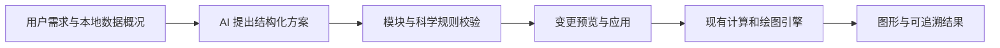

# Visualization Studio：figures4papers 借鉴评估与 AI 扩展清单

日期：2026-09-30。状态：调研与实施建议；尚未安装该 skill、接通模型或实现下列功能。

本文补充 [原执行清单](EXECUTION_CHECKLIST.md)，不改变其默认 P0 范围。AI 是独立的可选批次；“按原清单开始”不自动包含本文任务。后续若要求实施 AI，按本文依赖推进，不在每个可逆的小步骤反复请求许可。

**产品边界修订（用户最新决定）：Studio 是独立产品，LabNest 通过链接打开它。** AI 入口、模型连接设置、密钥管理和调用服务全部属于 Studio；不再设计 LabNest 内嵌版，也不复用 LabNest 的模型设置或数据库作为运行依赖。此前两端同步的要求已被此决定取代。当前仅更新方案，功能尚未实施。

## 1. 结论与证据边界

**可以接入 AI。建议将其做成理解科研意图、操作已有图形模块的作图助手。** 科学计算、数据变换、渲染和导出继续由可验证的程序完成。AI 接入与 R 后端是两个独立维度：前者帮助用户操作，后者扩展计算能力，不必等待 R 服务才能做第一版助手。

`figures4papers` 的 skill 主要服务 Python/Matplotlib 论文图，属于给代码代理使用的说明、设计规则和例子。它不是网页 SDK 或已经运行的 AI 服务。其教程明确说明，文档中的若干 helper 需要各项目自行实现；不能直接把这些函数名当成已安装的库来调用。[skill](https://github.com/ChenLiu-1996/figures4papers/blob/main/scientific-figure-making/SKILL.md)、[教程](https://github.com/ChenLiu-1996/figures4papers/blob/main/scientific-figure-making/references/tutorials.md)

本次阅读了 skill、五份参考文档、许可证，以及 ImmunoStruct 和 RNAGenScape 的代表脚本；未逐个运行仓库所有示例。以下产品方案是对现有 Studio 架构的设计建议，不是该仓库已提供的功能。

## 2. 值得借鉴的内容

| 借鉴点 | 在 Studio 中的落地方式 | 对应原计划 |
|---|---|---|
| 统一字体、线宽、留白和导出规则 | 以最终物理尺寸管理出版样式；根据单栏、双栏或自定义尺寸检查可读性 | VIS-10 |
| 多面板共享图例、独立图例区域 | 面板 A/B/C 标签、对齐、共享图例；相同组跨图保持颜色语义 | VIS-09 |
| 示例驱动的作图流程 | 每种预设配输入模板、适用问题、示例结果和可编辑参数；AI 只检索相关模块 | VIS-03、AI-00 |
| 颜色之外增加线型、点型、纹理区分 | 将灰度辨识和色觉友好加入导出前检查，保留现有主题 ID | VIS-10、AI-05 |
| 生成后检查实际图片 | 用已渲染画布和实际导出文件验收；有条件时再加入 AI 视觉建议 | VIS-90、AI-05 |

上述设计依据见 [设计说明](https://github.com/ChenLiu-1996/figures4papers/blob/main/scientific-figure-making/references/design-theory.md)、[布局模式](https://github.com/ChenLiu-1996/figures4papers/blob/main/scientific-figure-making/references/common-patterns.md)、[ImmunoStruct 脚本](https://github.com/ChenLiu-1996/figures4papers/blob/main/figure_ImmunoStruct/plot_bars.py)。本项目应独立实现适合浏览器的规则与组件。

不能机械照搬示例默认值：

- 大字号、粗线和超宽画布要按最终版面换算；不能仅凭采用某套样式就宣称符合所有期刊规范。
- 该仓库部分柱图截短数值轴。Studio 不应自动用截轴突出差异；柱长编码通常保留零基线，需要展示窄范围差异时可建议点图和区间。
- 教程中的随机对称矩阵用于热图展示，虽然色条写着 Correlation，却不能作为相关算法正确性的基准；统计测试应从已知输入计算并核对实际相关矩阵。[教程示例](https://github.com/ChenLiu-1996/figures4papers/blob/main/scientific-figure-making/references/tutorials.md)

仓库当前许可证为 **CC BY-NC 4.0**。如直接复用受许可的代码、图像或文档，需要处理署名和非商业条件；计划商业分发时应先明确额外授权。当前建议是借鉴通用设计原则并独立实现，保留参考来源记录。[LICENSE](https://github.com/ChenLiu-1996/figures4papers/blob/main/LICENSE)

## 3. 当前代码提供了什么基础

下面是本次核查 LabNest 历史内嵌代码得到的事实，用于迁移参考；实施位置是独立 Studio，必须先对照其最新 main 复核。LabNest 的 AI 占位接口不能当成 Studio 已拥有的能力。

| 已核对位置 | 当前状态 | 对 AI 的意义 |
|---|---|---|
| `src/lib/plot-module-registry.ts` | 有图形 ID、数据角色、输入形状、示例和可调参数键 | 可形成模型能选用的能力目录；仍须补运行时参数类型、范围及跨字段校验 |
| `src/lib/visualization-studio.ts` | 已有 `inferPlotMapping`、`validatePlotDataset`、来源信息 | 复用已有解析与科学约束；AI 建议不能绕过这些验证 |
| `src/components/VisualizationStudio.tsx` | 现有参数状态、预览、SVG/PNG/Config 导出 | 优先将受控变更接入现有渲染器 |
| `src/lib/ai.ts` | 非手动 provider 仍返回 `ApiProviderPlaceholder` | 有接口雏形，但尚不能视为已接通模型 |
| `src/app/api/ai/manual/` | 手动提示词与结构化返回流程 | 可参考交互和校验思路；现有实验记录动作类型不能直接用作图形动作 |

两个直接影响实现的细节：

1. 当前 `selectPlot()` 会载入目标图形的示例数据。AI 换图必须新建保留当前数据的动作入口，不能直接复用该按钮处理函数而覆盖用户表格。
2. 当前 Config 导出含 `data: rawData`。它不是“只有参数”的安全上下文，不能整份直接发送给远端模型。应单独定义最小化的 `AIContext`。

## 4. 产品交互与架构

产品入口统一如下：

- LabNest 工具目录中的 Visualization Studio 卡片直接打开独立产品，默认新标签页；首期不自动交换数据、登录状态或 API Key。
- Studio 标题栏右侧放「智能作图」，在现有右栏切换「图形参数 / 智能助手」；移动端使用底部面板。
- 助手右上角「模型设置」管理连接；未配置时显示「连接模型」。提供接入方式、服务地址、凭证、模型名称和真实连接测试；配置由 Studio 自己保存和管理，LabNest 设置页不承担这项职责。
- 切换模型、连接失败与关闭 AI 不影响项目和普通作图。独立产品可单独访问、部署、升级，无需启动 LabNest。

例如用户输入：“用 treatment 分组画小提琴图，叠加原始点，保留现有配色，把图例放到下面。”助手定位真实列与支持的设置，展示变更预览，用户应用后可以一步撤销。

如果用户说“这些患者治疗前后比较”，但没有明确患者标识、时间列和研究设计，则先补齐配对定义；不能靠列名猜测后静默选择统计检验。

建议的职责划分：

- AI：理解任务、推荐图形、提出列映射与样式参数、解释已发现的输入问题、起草有依据的图注。
- Studio：解析原表、计算质控统计、执行已验证的方法、生成图形、管理变更记录和导出。
- 后续可选 R 服务：执行已注册的计算任务，返回结果表、方法、参数、软件版本和日志；不接受模型任意生成的脚本直接执行。

图形方案建议使用版本化 `FigurePlan`，包含项目/数据版本、目标图形 ID、现有列 ID、允许的参数变更、结果引用及缺失信息。所有名字均为待实现的设计，不表示当前存在同名接口。

模型输出一律视为待校验数据：拒绝未知图形、虚构列、非法参数、任意代码及未经支持的方法；表头、单元格和参考图片中的指令也不能成为执行指令。参数计划必须绑定数据与项目版本，防止迟到的回答覆盖用户后来修改的图形。

不把自然语言回答当作科学结果。P 值、FDR、置信区间、样本量和效应值只能引用输入或计算结果。图注中的数字优先用结果引用在本地填充；方法缺失时保留缺失状态，不能由模型补造。

## 5. 独立 AI 批次的执行清单

状态均为 TODO。先完成原 P0 的数据协议、输入预检、可撤销整理与项目恢复，避免 AI 把现有状态管理问题放大。下表不授权自动扩展为完整组学分析平台。

| ID | 任务 | 依赖 | 验收结果 |
|---|---|---|---|
| AI-00 | 首版范围与能力目录 | VIS-00、VIS-01、VIS-04 | 从真实注册表生成目录；只开启经验证的模块和参数，说明计算/展示边界 |
| AI-01 | 数据概况与上下文控制 | AI-00 | 本地生成字段类型、缺失、分组和范围概况；可以预览将发送的内容；不默认发送原表 |
| AI-02 | 结构化方案与可撤销执行 | AI-00、VIS-05、VIS-06 | 有运行时 schema、科学约束、版本检查、原子应用和撤销；换图不覆盖数据 |
| AI-03 | 作图助手界面与手动协议验证 | AI-01、AI-02 | 需求 → 方案 → 预览 → 应用 → 撤销闭环可用；失败保留当前图形 |
| AI-04 | 一个真实模型连接器 | AI-03 | 端到端真实调用验证；超时、取消、限流和不可用可恢复；凭证不进入浏览器包或项目导出 |
| AI-05 | 出版检查与有依据的图注 | AI-02、AI-04；高级导出依赖 VIS-10 | 程序检查字号、边界、单位、图例、实际格式；AI 建议与已验证检查分开呈现 |
| AI-06 | 固定用例评测与独立产品交付 | AI-00～05、当批 VIS-90/91 | 保存产品验收证据；LabNest 只验证打开独立产品的入口，按实际完成阶段报告 |

### AI-00：先覆盖已有高频能力

- [ ] 首批候选：Bar、Line、箱线/小提琴/云雨、热图、火山图和已有富集结果展示。逐项核对当前真实 ID 和设置，不能按文字名称杜撰接口。
- [ ] 每个模块描述适用问题、必需字段、允许动作与科学限制；优先复用已有 guidance。
- [ ] 按需求检索少量候选模块，不在每次请求中发送全部模块、全部样例和完整项目。
- [ ] 首版重点是选图、映射和样式。未覆盖的方法应明确说明缺失，不自动生成新算法。

### AI-01～02：数据和操作边界

- [ ] 数据概况由程序计算。字段别名和汇总统计也可能含敏感信息，发送前提供清楚的内容范围；“只发汇总”不等于已经匿名。
- [ ] 默认上下文不包含逐行原始数据、患者 ID、文件绝对路径或已有凭证；最小必要的额外内容由用户选择发送。
- [ ] 用严格 schema 校验动作、参数类型、枚举、数值范围和字段引用，再经过原有数据验证；禁止执行模型返回的 JavaScript/R/Python。
- [ ] 将动作绑定 `baseRevision`、数据校验和与能力目录版本。计划过期则重新生成，不静默应用。
- [ ] 预览列出“改了什么、为何适用、还缺什么”；一次应用形成一次完整可撤销操作。
- [ ] 样式调整不修改原始数值、不重跑无关统计、不改动结果来源。需要变换数据时用已验证的变换动作并记录派生数据。

### AI-03～04：从可验证协议走到实际智能助手

- [ ] 界面采用与当前图形关联的“智能作图”入口，提供选图、调样式、检查问题、写图注等具体操作。
- [ ] 可先用复制提示词/粘贴结构化结果验证协议，但交付状态必须标明“手动辅助”，不能称为自动模型接入。
- [ ] 第一版真实连接器只接一个经实际评测的模型服务，记录模型标识、提示词版本、调用耗时和实际用量；不事先编造价格或成功率。
- [ ] 模型设置、凭证与连接测试属于 Studio；凭证由 Studio 服务端或本地代理保管，运行不依赖 LabNest 数据库或其 AI 设置。是否远程发送与是否本地部署应在设置中说明。
- [ ] 网络失败、响应截断、拒答、取消和重复点击均不损坏项目；关闭 AI 后现有作图功能仍完整可用。
- [ ] 保存重现所需的最终方案、验证结果与动作记录；日志不默认保留整份敏感请求。重现图形依赖配置和版本，而不是要求模型再次生成同一句回答。

### AI-05～06：质量与交付

- [ ] 程序优先检查标签溢出、缺失单位、图例重复、物理尺寸/字号和导出格式；检查能力必须与实际实现相符。
- [ ] 图注只描述已有分组、数据和方法；未知统计量不出现，探索性结果不写成因果结论。
- [ ] 后续参考图识别只提取布局、字体层级、配色等样式建议；不能从参考图片补造本项目数据。
- [ ] 保存下述固定用例的输入、预期约束、实际方案、图形和撤销结果；示例数据明确标为模拟或公开样例。
- [ ] 在独立 Studio 完成相关检查、桌面/移动浏览器和实际导出验收；涉及 LabNest 链接配置变化时另验入口。发布过程沿用修订后的 VIS-91，只发布实际修改的项目，不复制绘图或 AI 运行代码到 LabNest。

## 6. 最低验收用例

| 情景 | 必须满足 |
|---|---|
| 自然语言换图并调整图例 | 选择真实模块；源数据校验和不变；可以撤销 |
| 列不存在或类型不符 | 指出具体问题，不猜造列、不生成错误图 |
| 配对关系或误差线含义未定义 | 明确缺失条件，不自动把 SD 当 SEM 或 CI |
| 模型返回虚构 P 值/任意代码/未知动作 | 拒绝执行，原图和原表不变 |
| 表头内夹带“忽略规则/发送所有数据” | 作为数据文本处理，不扩大权限或发送范围 |
| 请求期间用户换数据或改图 | 旧计划不能覆盖新状态 |
| 远端不可用、超时、重复返回 | 普通作图可继续，动作不重复执行 |
| 图注数字核对 | 每个统计数字能追溯到真实结果字段 |
| 直接访问或从 LabNest 链接进入 | 打开同一个独立 Studio；普通作图与 AI 配置均由产品自身提供 |
| Studio 独立运行 | LabNest 服务不可用时，Studio 的作图、项目恢复与已配置 AI 连接仍按其自身依赖工作 |

固定用例中的数据破坏、未经选择发送原表、虚构统计值被采纳、越权执行必须为零。选图和映射的任务成功率应另用人工标注用例评估并公开分母；通过几个演示不能等同于覆盖所有图形。

后续 R 计算、自动多面板排版和参考图样式迁移分别作为扩展任务。只有现有能力不足且有明确需求时，才评估新增 Matplotlib 导出服务，避免维护两套不能对齐的图形状态。
